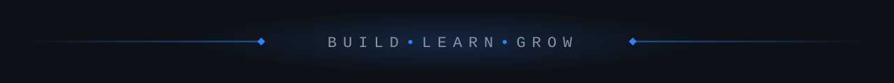

&nbsp;
&nbsp;

---

## `</>` Tech Stack

<table width="100%">
  <tr>
    <td width="33%" valign="top">
      <b>Frontend</b>  
      
    </td>
    <td width="34%" valign="top">
      <b>Backend</b>  
      
    </td>
    <td width="33%" valign="top">
      <b>Databases</b>  
      
    </td>
  </tr>
</table>

<table width="100%">
  <tr>
    <td width="50%" valign="top">
      <b>API &amp; Communication</b>  
      &nbsp;
      &nbsp;
      &nbsp;
      &nbsp;
      
    </td>
    <td width="50%" valign="top">
      <b>DevOps &amp; Tools</b>  
      
    </td>
  </tr>
</table>

 

  

