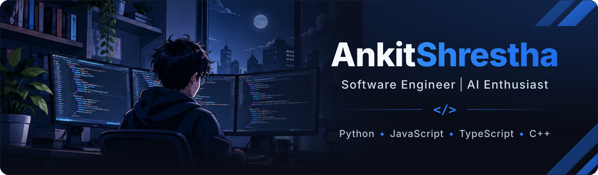

  

<table>
  <tr>
    <td align="center" width="210"><a href="https://www.linkedin.com/in/ankitshrestha7/">&nbsp;&nbsp;<b>LinkedIn</b></a> ankitshrestha7</td>
    <td align="center" width="210"><a href="https://medium.com/@ankitshrestha196">&nbsp;&nbsp;<b>Medium</b></a> @ankitshrestha196</td>
  </tr>
</table>

 

<h2 align="center">Tech Stack</h2>

FROM INTERFACE TO INFRASTRUCTURE 30 TOOLS &nbsp;·&nbsp; 5 LAYERS

<table>
  <tr>
    <td colspan="9"><code>01</code>&nbsp; <b>Frontend</b> &nbsp;— User interfaces</td>
  </tr>
  <tr>
    <td align="center" width="88"> HTML</td>
    <td align="center" width="88"> CSS</td>
    <td align="center" width="88"> Sass</td>
    <td align="center" width="88"> Tailwind</td>
    <td align="center" width="88"> Bootstrap</td>
    <td align="center" width="88"> React</td>
    <td align="center" width="88"> Next.js</td>
    <td colspan="2"></td>
  </tr>
  <tr>
    <td colspan="9"><code>02</code>&nbsp; <b>API &amp; Communication</b> &nbsp;— Contracts &amp; protocols</td>
  </tr>
  <tr>
    <td align="center" width="88"> REST API</td>
    <td align="center" width="88"> GraphQL</td>
    <td align="center" width="88"> gRPC</td>
    <td align="center" width="88"> Insomnia</td>
    <td align="center" width="88"> Postman</td>
    <td colspan="4"></td>
  </tr>
  <tr>
    <td colspan="9"><code>03</code>&nbsp; <b>Backend</b> &nbsp;— Services &amp; runtimes</td>
  </tr>
  <tr>
    <td align="center" width="88"> Python</td>
    <td align="center" width="88"> FastAPI</td>
    <td align="center" width="88"> Starlette</td>
    <td align="center" width="88"> Node.js</td>
    <td align="center" width="88"> Express</td>
    <td align="center" width="88"> TypeScript</td>
    <td align="center" width="88"> JavaScript</td>
    <td align="center" width="88"> Flask</td>
    <td align="center" width="88"> C++</td>
  </tr>
  <tr>
    <td colspan="9"><code>04</code>&nbsp; <b>Databases</b> &nbsp;— Storage &amp; caching</td>
  </tr>
  <tr>
    <td align="center" width="88"> PostgreSQL</td>
    <td align="center" width="88"> MySQL</td>
    <td align="center" width="88"> MongoDB</td>
    <td align="center" width="88"> Redis</td>
    <td colspan="5"></td>
  </tr>
  <tr>
    <td colspan="9"><code>05</code>&nbsp; <b>DevOps &amp; Tools</b> &nbsp;— Ship &amp; operate</td>
  </tr>
  <tr>
    <td align="center" width="88"> Git</td>
    <td align="center" width="88"> GitHub</td>
    <td align="center" width="88"> Docker</td>
    <td align="center" width="88"> Linux</td>
    <td align="center" width="88"> Bash</td>
    <td colspan="4"></td>
  </tr>
</table>

 

BUILD &nbsp;·&nbsp; LEARN &nbsp;·&nbsp; INNOVATE

